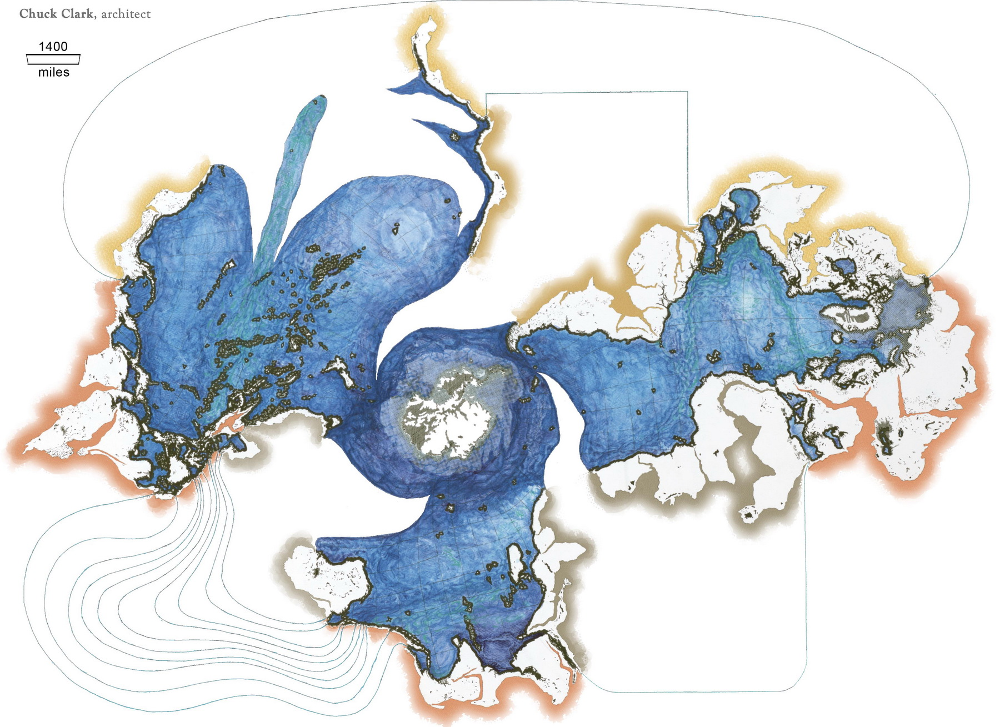
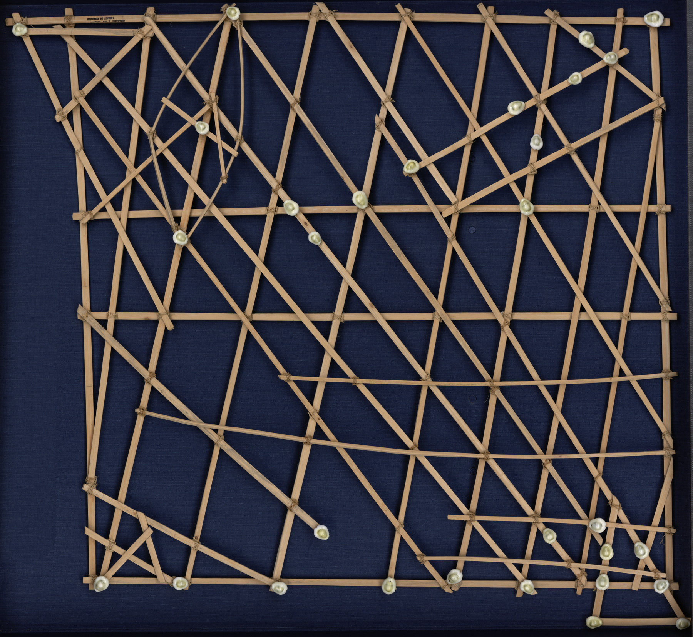
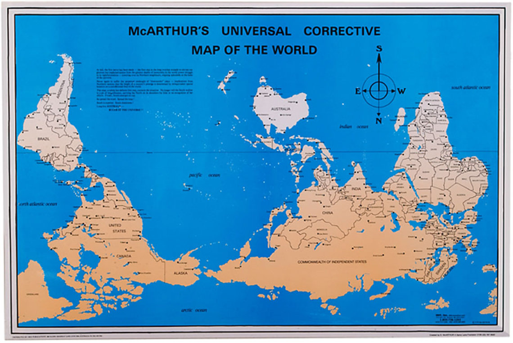
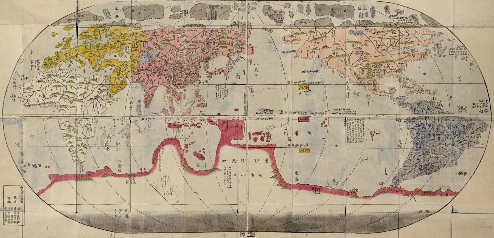
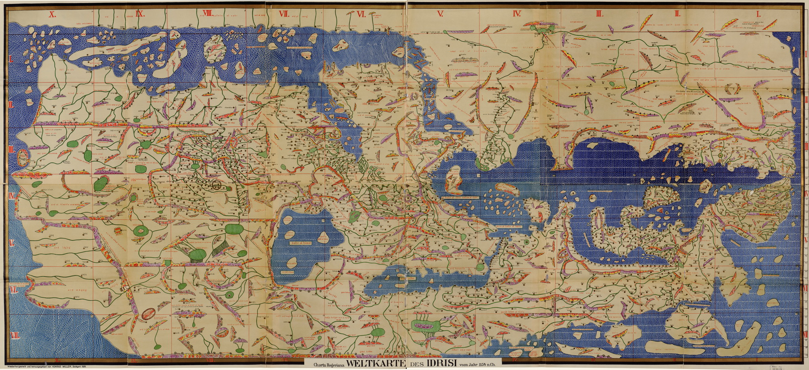
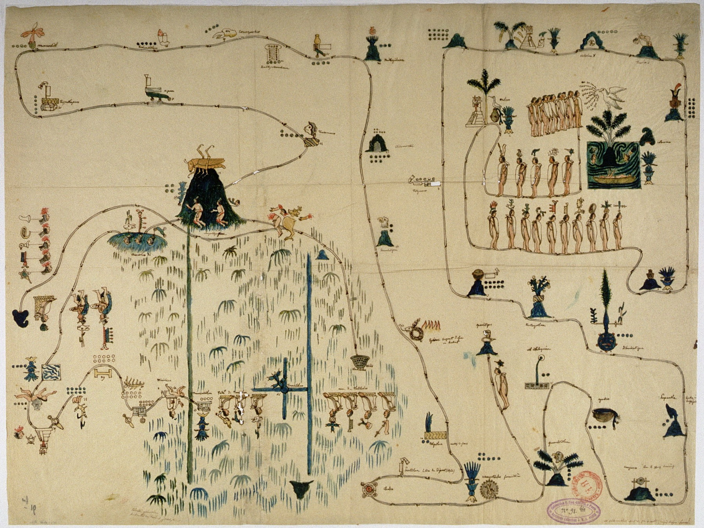
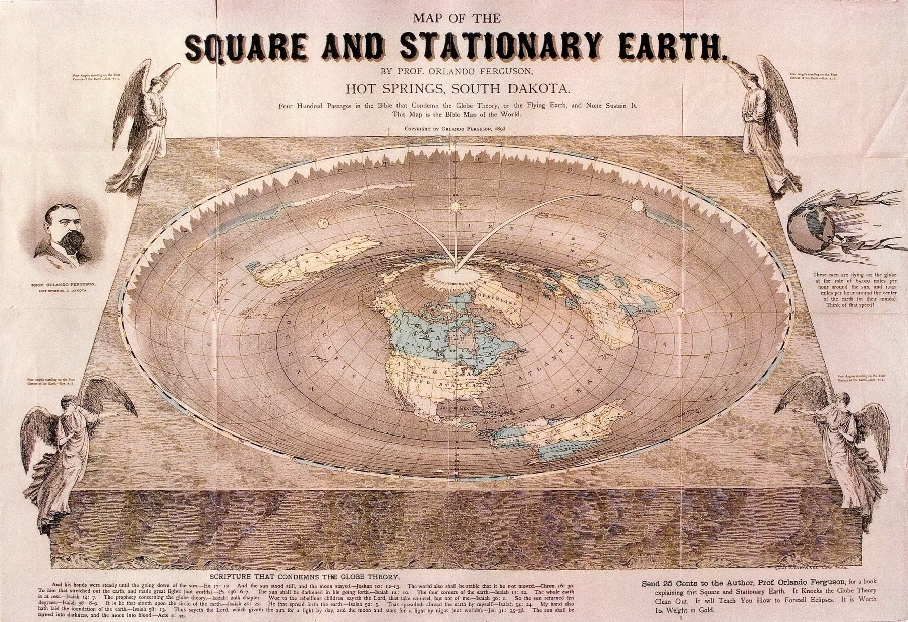
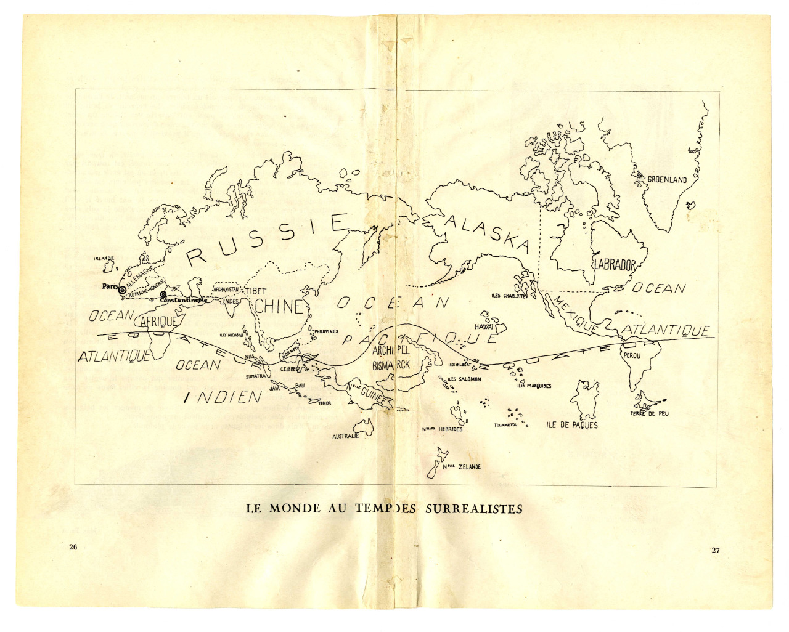
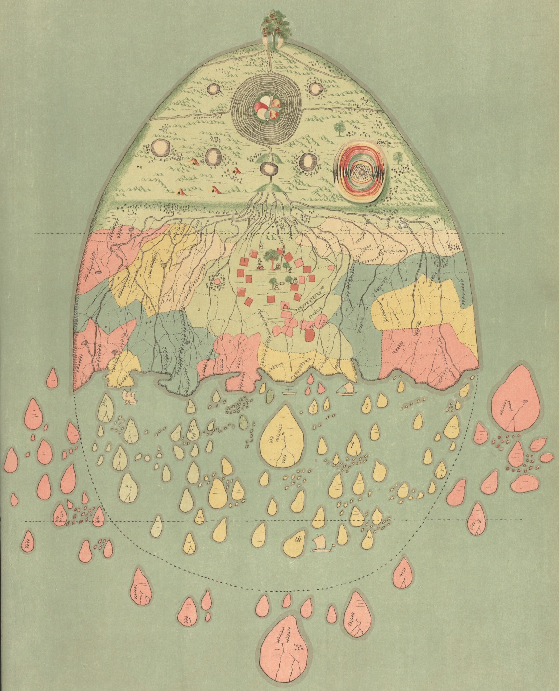

Η αντικειμενικότητα και η ουδετερότητα του χάρτη μπορεί να είναι κάτι ριζωμένο στο μυαλό των περισσότερων, αλλά όπως έχει δείξει η κριτική ματιά που έχει στραφεί από το δεύτερο μισό του εικοστού αιώνα στη χαρτογραφία και την ιστορία της[^1], αυτό είναι κάτι που δεν ισχύει. Η χαρτογραφική δραστηριότητα διατρέχεται από δίκτυα συμβάσεων και παραδόσεων, τα οποία είναι φορείς πολλαπλών εξουσιών, όσο αθόρυβες ή αόρατες και να είναι αυτές. Αναπόφευκτο βήμα μετά από αυτή τη συνειδητοποίηση είναι η αναζήτηση εξαιρέσεων, κάποιων παραδειγμάτων χαρτών (ανεξαρτήτως τόπου και χρόνου) που να αντιτίθενται (ηθελημένα ή μη) σε κάποιους από τους γενικούς κανόνες και συμβάσεις της νεότερης και σύγχρονης χαρτογραφίας:
{: class="firstletteris"}  
 

**1. Ocean Watersheds (~2008)**:

  
 

Μία από τις βασικότερες, και πλέον βαθιά ριζωμένες οπτικές συνήθειες της πλειοψηφίας των χαρτογράφων είναι η επικέντρωση στις χερσαίες μάζες, για προφανείς πρακτικούς λόγους. Ο συγκεκριμένος χάρτης, ο οποίος ανήκει σε μια κατηγορία που ονομάζεται CSNB (Constant-Scale Natural Boundary maps – περισσότερα μπορείτε να διαβάσετε σε [αυτό το blog](http://rightbasicbuilding.com/){:.text-blue-600 .hover:text-blue-400}), αντιτάσσεται σε αυτήν, αφήνοντάς τις ηπείρους σχεδόν στο background, υποχρωματισμένες, κατακερματισμένες, παρουσιάζοντας τους ωκεανούς ως το κυρίαρχο συνεχές. Πέρα από αυτό, η κεντρική θέση του Νοτίου Πόλου καταρρακώνει προσπάθειες παραδοσιακής χωροθέτησης των σημείων του ορίζοντα, όπως άλλωστε συμβαίνει με όλες τις πολικές χαρτογραφικές προβολές. Άλλο ένα πανέμορφο δείγμα CSNB χάρτη μπορείτε να δείτε [εδώ](https://rightbasicbuilding.files.wordpress.com/2008/05/purplething-copy2.jpg){:.text-blue-600 .hover:text-blue-400}.

Ο χάρτης σε πλήρης ανάλυση [εδώ](https://rightbasicbuilding.files.wordpress.com/2008/05/ocean_watersheds1.jpg){:.text-blue-600 .hover:text-blue-400}.  
 

**2. Marshall Islands Stick Maps (~1920)**:

  
 

Η απεικόνιση του στέρεου αναγλύφου, είτε χερσαίου είτε υποθαλάσσιου, είναι το πλέον σύνηθες στην χαρτογραφία. Στην χειρότερη υπάρχει έστω το περίγραμμα των χερσαίων μαζών στους συμβατικούς χάρτες. Από την άλλη, αυτό το περίεργο σύμπλεγμα ξύλων και κοχυλιών από τα νησιά Μάρσαλ είναι δείγμα ενός χάρτη ναυσιπλοΐας, ο οποίος αποτυπώνει τους ωκεάνιους μηχανικούς κυματισμούς (ocean swells) που επικρατούν στην περιοχή στην οποία αναφέρεται. Το συναρπαστικό του χάρτη έγκειται ακριβώς στο ότι επικεντρώνεται μόνο σε ένα τύπο πληροφορίας, αγνοώντας τυπικές για εμάς συμβάσεις πληροφορίας υποβάθρου, όπως το ανάγλυφο ή το περίγραμμα χερσαίων μαζών, επικεντρώνοντας αντί αυτού στην λειτουργικά απαραίτητη πληροφορία.

Ο χάρτης σε πλήρης ανάλυση [εδώ](http://www.bigmapblog.com/maps/map03/CXYQiujhPCJWlkbl01.jpg){:.text-blue-600 .hover:text-blue-400}.  
 

**3. McArthur's Universal Corrective Map of the World (1979)**:

  
 

Η τοποθέτηση του Βορρά στο πάνω μέρος του χάρτη είναι μια βαθιά ριζωμένη παράδοση στην νεότερη ιστορία της δυτικής χαρτογραφίας, σαφώς φορτισμένη ιδεολογικά και ιστορικοπολιτικά. Ο Αυστραλός Stuart McArthur είναι υπεύθυνος για τον μάλλον διασημότερο σύγχρονο χάρτη που δεν ακολουθεί την παραδοσιακή χωροθέτηση των σημείων του ορίζοντα: έχει τον Νότο στο επάνω μέρος, και μια ματιά αρκεί να δείξει το πόσο έχουμε συνηθίσει σε μια αυθαίρετη μεν, διόλου αθώα διαχρονικά δε, επιλογή. Ένας πολιτικός στην έμπνευση και υλοποίηση του χάρτης.  
 

**4. Japanese Woodblock World Map (1785)**:

  
 

Ένα άλλο πολύ διαδεδομένο μοτίβο της νεότερης δυτικής χαρτογραφίας είναι η κεντρική θέση της Ευρώπης στον παγκόσμιο χάρτη, άλλη μια επιλογή πλήρως φορτισμένη ιδεολογικά και ιστορικοπολιτικά, ουσιωδώς πολιτισμοκεντρική. Αυτός ο Ιαπωνικός χάρτης του 1785, αντίγραφο του θρυλικού κινέζικου χάρτη Kunyu Wanguo Quantu (στην δημιουργία του οποίου συμμετείχε και ο Ιταλός Matteo Ricci), έχει ως κεντρικό του σημείο την Άπω Ανατολή, με την Ευρώπη εξορισμένη στην πάνω αριστερά γωνία. Οι ίδιοι οι Κινέζοι αντιλαμβάνονταν τον κόσμο ως έχοντα 5 σημεία κατευθύνσεων, τα τέσσερα γνωστά και το Κέντρο, το οποίο αντιστοιχούσε με την ίδια την Κίνα, η οποία προφανώς έπρεπε να έχει την κεντρική θέση σε κάθε χάρτη[^2].

Ο χάρτης σε πλήρης ανάλυση [εδώ](http://www.bigmapblog.com/maps/map01/FHTJdpryBKBIjqnv.jpg){:.text-blue-600 .hover:text-blue-400}.  
 

**5. Idrisi World Map (1154)**:

  
 

Ένας συγκερασμός των δυο προηγούμενων συμβάσεων, ο χάρτης του μουσουλμάνου γεωγράφου του 12ου αιώνα Al-Idrisi είναι δείγμα μιας μη δυτικής παράδοσης, με τον Νότο να βρίσκεται στο επάνω μέρος, ενώ το κέντρο να συμπίπτει σχεδόν με τη Μέκκα.

Ο χάρτης σε πλήρης ανάλυση [εδώ](http://www.bigmapblog.com/maps/map01/YDKRvrsmOFNUnsum.jpg){:.text-blue-600 .hover:text-blue-400}.  
 

**6. The Sigüenza Map (16ος αιώνας)**:

  
 

Είναι λίγο πολύ κοινή σύμβαση πως η μεγάλη πλειοψηφία των χαρτών με τους οποίους ερχόμαστε σε επαφή δεν εμπεριέχουν κάποιον χρονικό παράγοντα και επικεντρώνονται αποκλειστικά στο χωρικό, σαν να είναι στιγμιότυπα εντός της ροής του χρόνου. Αυτή η φαινομενική αχρονικότητα στο περιεχόμενο του χάρτη έχει ρίζες (και) στην Αναγέννηση και το Διαφωτισμό – οι περισσότεροι μεσαιωνικοί χάρτες εμπεριείχαν και χρονική διάσταση (για περισσότερα ανατρέξτε στο The Darker Side of the Renaissance[^3] και στο History of Cartography[^4]). Ο συγκεκριμένος χάρτης των Αζτέκων περιλαμβάνει χωρική και χρονική διάσταση, απεικονίζοντας την αποδήμηση του λαού από τη μυθική κοιτίδα Aztlan στο Tenochtitlan. Η χρονική διάσταση εντοπίζεται στα απεικονιζόμενα γεγονότα που διαδραματίζονται κατά τη διάρκεια του μυθικού αυτού ταξιδιού.

Ο χάρτης σε πλήρης ανάλυση [εδώ](https://dl.wdl.org/3247.png){:.text-blue-600 .hover:text-blue-400}.  
 

**7. Square & Stationary Earth (1893)**:

  
 

Η σφαιρικότητα της Γης είναι κάτι που υπονοείται ή εμφανίζεται ξεκάθαρα σε πρακτικά όλους τους παγκόσμιους χάρτες της νεότερης εποχής. Ο συγκεκριμένος χάρτης είναι μια από τις ελάχιστες εξαιρέσεις, μια από τις τελευταίες απόπειρες για απεικόνιση μιας τετράγωνης και στατικής (και,  μεταξύ μας, ελαφρώς ρουλετοειδούς) Γης. Υπεύθυνος για αυτό το ανακριβές μεν, πανέμορφο δε έργο τέχνης είναι ο Αμερικανός Orlando Ferguson.

Ο χάρτης σε πλήρης ανάλυση [εδώ](https://upload.wikimedia.org/wikipedia/commons/1/13/Orlando-Ferguson-flat-earth-map_edit.jpg){:.text-blue-600 .hover:text-blue-400}.  
 

**8. Surrealistic Map of the World (1929)**:

  
 

Κάτι που αναμφισβήτητα είναι συνυφασμένο με τους σύγχρονους χάρτες είναι η (φαινομενική) αίσθηση της αντικειμενικότητας και της αυθεντίας, της επιστημονικότητάς τους. Σε αυτόν τον χάρτη του Μεσοπολέμου, κάποιος από τους Ντανταϊστές (πιθανολογείται ο Paul Éluard) εναντιώνεται σε αυτή την αίσθηση, αποτυπώνοντας τον κόσμο μέσω υποκειμενικής ματιάς. Το αποτέλεσμα περιέχει έναν τρελαμένο ισημερινό (χλευάζοντας την καθώς πρέπει κανονικότητα του επιστημονικού πλέγματος των μεσημβρινών και παραλλήλων), και δυσαναλογίες μεταξύ πραγματικών και αποτυπωμένων μεγεθών, τόσο χωρών, όσο και ολόκληρου του νοτίου ημισφαιρίου. Κυκλοφορούν κάποιες αναλύσεις του, [εδώ](http://jacket2.org/commentary/avant-garde-ii-surrealist-map-world){:.text-blue-600 .hover:text-blue-400} είναι μια καλή αφετηρία.  
 

**9. Burmese map of the world (1906)**:

  
 

Για κλείσιμο άφησα αυτόν τον πανέμορφο βιρμανικό (πιθανότατα με επιρροές από μεσαιωνική ευρωπαϊκή χαρτογραφία) παγκόσμιο χάρτη, ο οποίος βρίσκεται στο βιβλίο *The Thirty-Seven Nats — A Phase of Spirit-Worship prevailing in Burma*, του Άγγλου Sir Richard Carnac Temple. Ο χάρτης περιέχει στοιχεία τοπικής κοσμογονίας, εμπλουτίζοντας το χωρικό με το χρονικό στοιχείο, θυμίζοντας έτσι τόσο τον προαναφερθέντα χάρτη των Αζτέκων, όσο και τους μεσαιωνικούς Mappa Mundi, ακόμη και στην λάθος για τα σημερινά δεδομένα προοπτική και αναλογία.  
 

**Βιβλιογραφία**:

[^1]: Deconstructing the map, Harley, 1992 (http://quod.lib.umich.edu/p/passages/4761530.0003.008/--deconstructing-the-map?rgn=main;view=fulltext)
[^2]: Science & Civilization in China, Needham & Ling, 1959 
[^3]: The Darker Side of the Renaissance, Mignolo, 1995
[^4]: History of Cartography, Vol.1,2,3, Harley & Woodward(eds), 1987-2007(http://www.press.uchicago.edu/books/HOC/HOC_V1/Volume1.html)